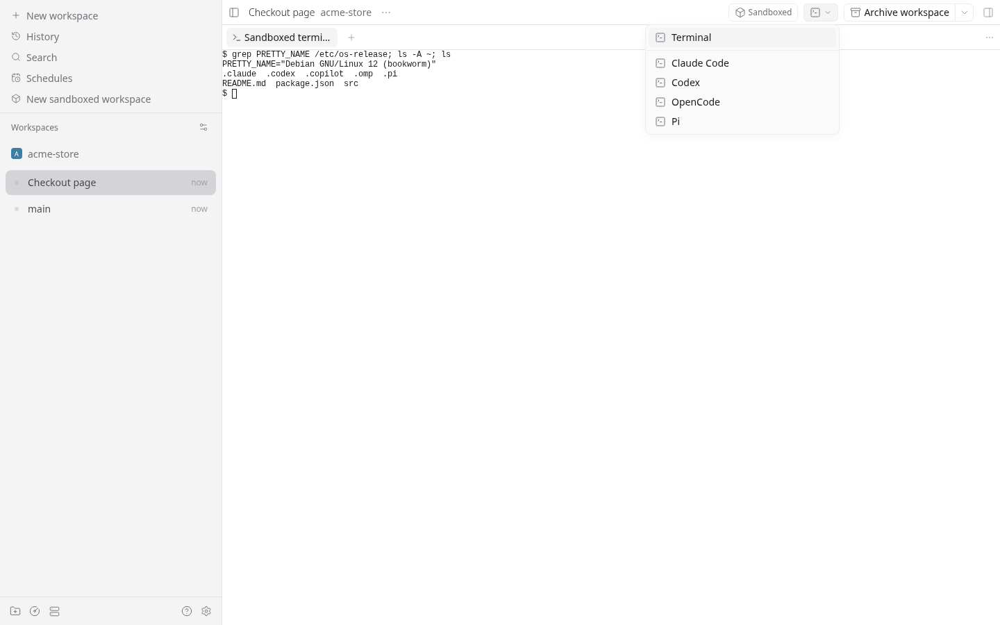

# Workspace Sandbox for Paseo

A [Paseo](https://paseo.sh) plugin that runs a workspace's agents and terminals in a sandbox that
sees only the workspace, your agents' own state, and the folders you add. A sandbox is a Podman or
Docker container, a microsandbox microVM, or a Bubblewrap sandbox built from the host's system.



- **New sandboxed workspace** (sidebar header, Command Center, or the workspace command that
  preselects the current project) creates a workspace in a new worktree or the project directory,
  with a [container profile](#container-profiles-and-engines), and opens it at once. Its sandbox
  starts in the background.
- Agents start from the workspace's own composer, with attachments, modes, and commands. Each one
  switches to a sandboxed copy of the provider it asked for, such as `claude-sandbox` or
  `zai-sandbox`; see [Provider profiles](#provider-profiles). Sessions, permissions, and history
  work as usual.
- The **Sandboxed** header button opens the Sandbox panel: the sandbox's configuration, its Claude
  folder and sign-in, and **Open sandboxed terminal**. The terminal button beside it opens a menu of
  a shell and your terminal profiles, run in the sandbox.
- Each sandbox gets its own Claude Code config folder and signs in with the host's current access
  token, never its refresh token; see [Claude Code sign-in](#claude-code-sign-in).
- Archiving the workspace removes its sandbox.

## Install

From a checkout (the plugin has no runtime dependencies):

```sh
paseo plugin install "$PWD"
```

From Git:

```sh
paseo plugin add git:bendavid/paseo-workspace-sandbox
```

The plugin needs Paseo 0.13.0 or later and one of the [engines](#container-profiles-and-engines)
on the daemon's machine. It has been tested on Linux.

Installing it edits daemon configuration: the first time each provider runs in a sandbox, the
plugin adds a `<provider>-sandbox` provider profile to `config.json`. The profiles stay after the
plugin is removed, so agents saved with one fail instead of resuming on the host. To uninstall,
remove the plugin, delete the `*-sandbox` profiles from `config.json`, then delete
`$PASEO_HOME/plugin-data/workspace-sandbox`.

## Container profiles and engines

A profile is a saved sandbox configuration: engine and its command, image, network, extra mounts,
and extra run arguments. A new workspace copies the profile chosen in the form, so editing or
deleting a profile never changes an existing sandbox; the Sandbox panel shows the copy. The form's
**Container** dropdown has **New profile** (prefilled from the selected one) and **Edit**, and
Settings > Sandbox lists the profiles. The first profile uses Podman, or Docker when only Docker is
installed. Profiles live in `container-profiles.json` in the plugin's data folder.

| Engine                  | Sandbox                          | Image            | Network: Host / Separate / None                     | Tested                                  |
| ----------------------- | -------------------------------- | ---------------- | --------------------------------------------------- | --------------------------------------- |
| Podman                  | One container per workspace      | Yes              | `--network host` / `bridge` / `none`                | Yes                                     |
| Docker                  | One container per workspace      | Yes              | as Podman                                           | Through podman-docker                   |
| Bubblewrap              | One namespace sandbox per launch | No               | host network / not offered / `--unshare-net`        | Yes                                     |
| microsandbox            | One microVM per workspace        | Yes              | `--net all` / `--net public` / `--no-net`           | Yes (0.7.11)                            |
| Apptainer / Singularity | One container per launch         | Yes, or a `.sif` | host network / not offered / `--net --network none` | Apptainer 1.5.4 (also as `singularity`) |

Bubblewrap, Apptainer, and Singularity have no separate network without root, so they offer only
Host and None.

The profile's **Command** is the engine's executable; empty means the default (`podman`, `docker`,
`bwrap`, `msb`, `apptainer`, `singularity`) on `PATH`, or `~/.microsandbox/bin/msb`. Container runtimes such as krun, gVisor,
or Kata go in **Extra run arguments** (`--runtime krun`).

- **Podman and Docker** keep a long-lived container that launches join with `exec`. Run as host
  user, Podman uses `--userns=keep-id` and Docker `--user <uid>:<gid>`; see
  [User](#user).
- **Bubblewrap** keeps nothing between launches: each one is a fresh sandbox with the host's `/usr`,
  `/etc`, and `/opt` read-only, its own `/proc`, `/dev`, `/tmp`, and `/run`, the sandbox's mounts,
  and a clean environment. Tools are the host's own. The home directory is a scratch folder for the
  launch unless a mount covers it. It needs unprivileged user namespaces; starting the sandbox runs
  `true` in one, so a host without them shows a start failure. Extra run arguments go to `bwrap`.
- **microsandbox** keeps a libkrun microVM per workspace and joins it with `exec`, sharing host
  folders over virtio-fs at the same paths, with `-u <uid>:<gid>` run as host user. Each launch's
  variables are passed as `-e NAME`, which keeps their values off its command line. libkrun does not
  strictly confine a guest to a shared folder's subtree, so share narrow folders.
- **Apptainer and Singularity** start a fresh container per launch, like Bubblewrap, with
  `apptainer exec --containall --cleanenv --writable-tmpfs`: no automatic mounts of your home,
  the working directory, or `/tmp`, none of the daemon's environment, and a writable layer over the
  read-only image for the launch. They run as you and add your account to the container's
  `/etc/passwd` themselves, so there is no Run as host user setting; the home directory is a
  scratch folder for the launch unless a mount covers it. The image is a full registry reference,
  pulled with `apptainer pull` into `images/` in the plugin's data folder after you agree, with the
  registry's digests recorded beside it for the freshness check, or the absolute path of a local
  `.sif` file, used as it is. Both engines evaluate `--env`, `--env-file`, and `APPTAINERENV_*`
  values as shell words, expanding `$` and command substitutions, so the plugin passes no value
  through them: the base environment is written into a small `sh` loader, shell-quoted, and each
  launch's variables arrive on an open file descriptor that the launcher deletes before the engine
  starts. The Singularity engine uses the `singularity` command, SingularityCE's or Apptainer's
  compatible one; only the latter is tested.
- **BoxLite** is not supported: version 0.10.8 fails with more than two shared folders on x86_64
  (`IrqsExhausted`), and a sandbox needs at least three.

## What a sandbox sees

Each sandbox mounts, at the same absolute paths:

| Path                                        | Access     | Why                                                   |
| ------------------------------------------- | ---------- | ----------------------------------------------------- |
| Workspace directory                         | read-write | The agent's work                                      |
| Source checkout `.git`                      | read-write | A worktree's objects and refs live there              |
| `.git/hooks`, `.git/config`                 | read-only  | Both run on the host whenever git runs there          |
| `.git/worktrees`                            | read-only  | Other worktrees look missing inside; see below        |
| `.git/worktrees/<this worktree>`            | read-write | The worktree's own HEAD, index, and logs              |
| The workspace's own Claude folder           | read-write | See [Claude Code sign-in](#claude-code-sign-in)       |
| `~/.codex`, `~/.copilot`, `~/.pi`, `~/.omp` | read-write | Credentials, and history the daemon reads on the host |

The Claude folder and provider rows apply when the profile's **Share agent sign-ins and history**
setting is on, the default; see [Claude Code sign-in](#claude-code-sign-in). The `.git` rows apply
to sandboxed worktrees. The repository's other worktrees are not mounted, so
git in the sandbox sees them as missing, and `git worktree prune` there would remove them on the
host too. Their entries stay read-only, so pruning them fails, as does `git worktree add`, and
`git worktree repair` can only change this worktree's own entry; committing and switching branches
work. A sandboxed directory shares the project directory by
design and has no `.git` handling.

### User

The profile's **Run as host user** setting, on by default, applies to Podman, Docker, and
microsandbox; Bubblewrap always runs as you.

- **On:** commands run as your uid and gid, `HOME` is your host home path, and `USER` your user
  name. When the sandbox is created, the plugin writes an account for you into its `/etc/passwd`
  and `/etc/group`, with your name, group, home, and `/bin/sh`, replacing whatever the image had
  for that uid or name, such as the Node images' `node` account for uid 1000. Tools that read the
  account instead of `HOME`, such as OpenSSH looking for `~/.ssh`, then agree with `HOME`. Files
  written to mounts belong to you.
- **Off:** commands run as the image's default user, often root, with its own home and dotfiles.
  The provider folders are still mounted at their host paths, and linked from the image user's
  home (`~/.codex` and so on) so agents find them. Files written to mounts belong to whoever that
  user maps to: you with rootless Podman's root and with microsandbox, but root with Docker's
  root, or another uid for a non-root image user. Git is told to accept repositories owned by
  others (`safe.directory`), since it otherwise refuses them.

When running as host user, only the explicit mounts exist under `HOME`. A container engine creates it owned
by root as the parent of the provider directories, so it is not writable: tools that write
elsewhere in `~`, such as npm's cache, `~/.cache`, or `~/.config`, fail until you add those
directories, or `~` itself, under extra mounts.

Extra mounts are host paths, one per line or comma separated, with `:ro` for read-only. They may
contain the mounts above: mounts are applied parents first, so `~:ro` gives a read-only home around
a read-write workspace. At a path the plugin already mounts, the plugin's access wins, so the
workspace stays writable and git hooks and config stay read-only. Two extra mounts of one path are
read-only if either is. The host network lets agents reach the daemon's MCP endpoint on loopback.

### Image

Engines other than Bubblewrap run an image, given as a full reference that names its registry
(`docker.io/library/node:22`, `localhost/agents`): engines resolve short names differently, and
the download confirmation shows exactly what is fetched.

Sandboxes are created from the current version of their image, and nothing downloads an image
without your go-ahead. Every run and create passes `--pull never`, and the plugin pulls only after
you agree to that exact reference.

Whenever the plugin is about to run the image, for the Claude folder check or to create the
container or microVM (retries included), it compares the local copy with the registry:

- It asks the registry for the tag's current digest with a `HEAD` request, answering the
  registry's anonymous token challenge. Docker and Podman record that index digest, so this
  settles it. microsandbox records this platform's manifest digest, so when the index digest does
  not match, the plugin reads the index once to find this platform's entry. A `@sha256:` reference
  needs no request.
- A missing or outdated image waits for your go-ahead. In the form, Create asks first: **Create
  workspace and download `<image>`** (or **update**), for an outdated image **Create workspace with
  the local image**, or Cancel, which creates and downloads nothing. When a sandbox is recreated
  later, its start fails without downloading, and the Sandbox panel offers **Download** or
  **Update `<image>`**, and **Use the local image** for an outdated one. Each answer covers that
  one start and is never stored, so retries, daemon restarts, and agent launches never download
  and a later recreation asks again.
- When the registry can't be reached or needs credentials, a local image is used as it is, as is a
  `localhost/` image or one built locally.

Restarting an existing container or microVM, such as after a reboot, checks and downloads
nothing.

The first profile's image, `docker.io/library/node:22-bookworm-slim`, has no agent CLIs. Build one that installs them, or mount them from the host under extra mounts:

```dockerfile
FROM docker.io/library/node:22-bookworm-slim
RUN apt-get update && apt-get install -y --no-install-recommends git ca-certificates \
 && npm install -g @anthropic-ai/claude-code @openai/codex
```

A mounted CLI must be on the `PATH` the sandbox's login shell builds, or add its directory with
`--env-merge PATH=/its/dir:${PATH}` under extra run arguments (Podman only; Docker's `-e` does not
expand `${PATH}`).

### Environment

A sandboxed terminal runs the sandbox's interactive login shell: `bash -il`, or `sh -il` when the
image has no bash. Agents and terminal profiles start without a shell, so the first launch in each
sandbox captures the environment that shell builds and later ones reuse it. Starting each through
the shell would be slower, and anything the dotfiles print would reach the agent's protocol stream.

- The capture lives in `workspaces/<id>.env`, readable only by you, because dotfiles can export
  secrets. A recreated container captures again. Delete the file to pick up changed dotfiles.
- Variables `sandbox-run` forwards for each launch (`PASEO_*`, provider, and locale variables)
  override captured ones.
- Running as host user, your dotfiles only take part when an extra mount covers them, such as
  `~:ro`; otherwise the image user's own dotfiles do.

## Claude Code sign-in

Everything in this section, and the provider folders' mounts, depends on the profile's **Share
agent sign-ins and history** setting, on by default for every engine. Turned off, the sandbox gets
no Claude folder of the plugin's, no copy of your access token or `apiKeyHelper`, no shared Claude
entries or plugins, no `~/.codex`, `~/.copilot`, `~/.pi`, or `~/.omp`, and no links to them; the
plugin runs no Claude folder check for it, and the session hook sets no `CLAUDE_CONFIG_DIR`. Agents
then start signed out unless the image, an extra mount, or a forwarded variable such as
`ANTHROPIC_API_KEY` provides credentials, and they keep their sessions inside the sandbox, where
Paseo may not find them to show history or resume. The host login is only refreshed while some
sandbox uses a private Claude folder.

With the setting on, each new sandbox gets its own Claude config folder, `homes/<workspace id>/claude` in the plugin's
data folder, mounted at that path and set as `CLAUDE_CONFIG_DIR`. Transcripts, prompt history, and
file history stay in it, so agents can't read or change another workspace's sessions. The session
hook passes the same `CLAUDE_CONFIG_DIR` to the daemon, which reads transcripts there. The folder
stays after the workspace is archived, so its agents' history stays readable.

- From your host folder, `CLAUDE.md`, `agents/`, `commands/`, `skills/`, and `output-styles/` are
  mounted read-only, and `plugins/` is the read-only `CLAUDE_CODE_PLUGIN_SEED_DIR`.
- `settings.json` is your host's, rewritten whenever the plugin reconciles, with `apiKeyHelper`
  added. `.claude.json` is copied once without its `projects` map.
- An extra mount that shows your host folder read-only, such as `~:ro`, stays: the sandbox can read
  the host folder, including `.credentials.json`, but Claude Code uses the private folder. Anything
  that used the refresh token in there would sign the host out.
- When the sandbox's own configuration already makes your host folder writable, it uses the host
  folder, with no private folder or helper.

The decision is made once per sandbox, as it first starts, and the Sandbox panel shows it with its
reason. A throwaway sandbox with the profile's image, user mapping, workspace, extra mounts, and
extra run arguments, but none of the plugin's Claude mounts, checks the folder: it is shared only
when a marker file the host just created shows there and a file can be created next to it. This
catches `-v` in extra run arguments, symlinks, named volumes, and permissions. Anything else is
private, a failed check included: wrongly sharing would grant writes the mounts withheld, while
wrongly keeping it private only stops sharing transcripts.

### Sign-in

A sandbox never gets your host's refresh token. Each refresh issues a new refresh token and the old
one stops working, so a sandbox that refreshed a copy would sign out the host and every other
holder. The credentials file can't be shared another way: Claude Code saves it by rename, does not
follow a symlink for it, and always keeps it in the config folder.

Instead, sandboxes sign in with your host's current access token:

1. The plugin copies the access token alone to `auth/claude-access-token` (mode `600`), and its
   `apiKeyHelper`, `auth/claude-api-key-helper`, prints it. Both are mounted read-only through the
   `auth/` folder, since a file mount would keep the replaced file. Claude Code re-runs the helper
   every five minutes and after a 401, so long sessions follow your host's refreshes.
2. The plugin re-reads `.credentials.json` once a minute, at every sandboxed agent launch, and after
   its own refreshes.
3. About four minutes before the token expires, the plugin runs `claude auth status` on the host.
   It is the cheapest command that refreshes: Claude Code refreshes a token with less than about
   five minutes left when it starts, and `auth status` sends no model request. It goes through
   Claude Code's own lock, so it can't collide with your sessions.

`/login` on the host revokes nothing; sandboxes switch to the new token at the next read. `/logout`
revokes the refresh token and every access token issued with it, so sandboxed agents fail at once,
and the header button reads **Sign in on host** within a minute.

A `CLAUDE_CODE_OAUTH_TOKEN` that reaches the sandbox, from the Claude provider's env or the
daemon's, takes over: the helper prints it, because `apiKeyHelper` ranks above that variable.
`ANTHROPIC_API_KEY` and `ANTHROPIC_AUTH_TOKEN` rank above the helper, so providers such as Z.AI keep
their own credentials. On macOS, Claude Code keeps its login in the Keychain, which the plugin does
not read; set `CLAUDE_CODE_OAUTH_TOKEN` there.

## Provider profiles

Each time an agent is created in a sandboxed workspace, the plugin derives `<provider>-sandbox` from
the requested provider's current configuration, writes it if it is missing or stale, and switches
the agent to it. Editing the source provider reaches its sandboxed profile with the next agent.

- The profile extends the built-in at the root of the provider's `extends` chain, or `acp`, and
  carries the chain's command, env, options, models, and disallowed tools. A daemon fails to load a
  profile that extends one listed after it, so profiles never extend each other.
- The command is the provider's configured command, or the built-in default (`claude`, `codex`,
  `copilot`, `pi`, `omp`), behind `sandbox-run agent`. The daemon appends each provider's own
  arguments, such as `app-server` or `--acp`, after it.
- ACP providers (Copilot and `extends: "acp"`) get `clientCapabilities` with terminal and file
  access turned off, on the profile and on each agent, because Paseo would otherwise run their
  commands on the host.
- Paseo tools are disabled because they reach host terminals, scripts, and other agents.
- `state.json` records which profiles the plugin owns. An existing profile with the same ID that the
  plugin did not create is refused.

OpenCode is refused: it runs one server for every session on the daemon. Plugin-registered
providers are refused because a profile cannot extend them. The daemon checks the requested
provider before plugin hooks run, so an agent started in a sandboxed workspace needs its provider
available on the host too.

Paseo runs some provider commands without an agent session: model discovery, version checks, and
history for agents whose sandbox is gone. `sandbox-run` runs these with the host's CLI, so images
should carry the same CLI versions as the host. Agent sessions never fall back to the host.

## How it works

The plugin alone starts, recreates, and waits for sandboxes; `sandbox-run` only joins a running
one. One start per workspace runs at a time, and everything that needs the sandbox joins it:

- Creating a workspace starts the first one, which also decides the Claude folder.
- The `agent.session_open` hook waits up to 25 of its 30 seconds before every agent launch: the
  daemon needs the session's `CLAUDE_CONFIG_DIR` before the session starts.
- Opening a sandboxed terminal waits up to 45 seconds of the RPC's 60.
- Starting a stopped container, such as after a reboot, takes a second or two. Only an image
  download you agreed to runs longer; launches are refused with "still downloading" while it goes
  on.

A failed start turns the header button into **Sandbox failed**, with the engine's last error line as
its tooltip, and the Sandbox panel shows the error. Agent launches and sandboxed terminals fail with
"The sandbox did not start: …". Each launch tries again, and a sandbox that then runs clears the
failure. The daemon log has the engine's full output.

The plugin keeps `bin/sandbox-run`, `state.json`, `container-profiles.json`, a `workspaces/<id>.sh`
spec and its captured `.env` per sandbox, the private Claude folders in `homes/`, sandboxed
directories' links in `links/` and `link-mounts/`, and the token and helper in `auth/`, in
`$PASEO_HOME/plugin-data/workspace-sandbox`. The plugin cannot read its
runtime ID, so the folder uses the manifest ID: install it once per daemon. Removing the plugin
leaves the folder, and the provider profiles still point at `sandbox-run`, so sandboxed agents keep
failing closed.

| Launch                       | Sandbox from                                              | Without a sandbox            |
| ---------------------------- | --------------------------------------------------------- | ---------------------------- |
| Agent session                | `PASEO_SANDBOX_WORKSPACE_ID`, set by `agent.session_open` | Fails (`PASEO_AGENT_ID` set) |
| History of an archived agent | `PASEO_SANDBOX_ROUTE=host`, set by `agent.session_open`   | Host CLI                     |
| Model or version check       | none                                                      | Host CLI                     |
| Sandboxed terminal           | `PASEO_WORKSPACE_ID`, set on every terminal               | Fails                        |

The spec holds the engine's part of `sandbox-run`: a few shell functions (ready, ID, run a command
inside, signal), documented at the top of `server/wrapper.ts`. Killing a long-lived engine's `exec`
client does not stop the process inside, so the wrapper records the inner pid and forwards `TERM`,
`INT`, and `HUP`; Bubblewrap's launch replaces the wrapper and dies with it.

### Sandboxed directories

**Sandboxed directory** is the sandboxed counterpart of New workspace's "Local": a workspace on the
project directory, titled `<project> (sandboxed)` unless you name it. Projects that are not Git
repositories always get one. It shares the project directory with the project's other workspaces by
design, so its sandbox does not protect `.git` the way a sandboxed worktree's does.

The workspace lives at its own link to the project directory, `links/<workspace id>` in the
plugin's data folder, and Paseo shows that path as its directory. The plugin's hooks only see an
agent's directory when it is created, and commit-message and similar helpers only get a directory,
so the link is what tells the sandboxed workspace's agents and helpers apart from the project's
other workspaces, and two sandboxed directories on one project from each other. Agents of the other
workspaces run in the real path and keep their own provider.

Inside the sandbox the project is mounted at the link path, where the agent runs, and at its real
path, so files that contain the real path keep working: virtual environments, absolute symlinks,
build caches. An extra mount that covers the plugin's data folder, such as `~:ro`, would show the
link there as a symlink, and engines follow a symlink at a mount's destination; each sandbox
mounts its own `link-mounts/<workspace id>` over `links/`, so the link path stays a plain mount
point. Archiving the workspace removes the link.

Sandboxed directories created before links use the project directory itself. There, an agent of
an unsandboxed workspace in that directory still gets the sandboxed provider at creation, and the
session hook, which sees the workspace, runs it on the host, labelled as sandboxed (for example
"Claude Code (sandboxed)"), with Paseo tools disabled and, for ACP providers, Paseo's terminal and
file access off. When the daemon passes no workspace (agents saved without one, or a session
resumed through the SDK's `resumeAgent`), the directory decides and the agent stays sandboxed. An
agent whose workspace had a sandbox that is gone shows its history but does not run again; the
plugin remembers removed sandboxes in `state.json` for this.

## Not sandboxed

The plugin covers what the plugin API reaches. Everything else still runs on the host:

- Terminals Paseo opens itself, including its new terminal and terminal profiles, `paseo.json`
  scripts and services, and worktree setup and teardown. For an untrusted repository, setup alone
  defeats the sandbox.
- Git that the daemon runs in the workspace. The agent can write the workspace's `.git` file and
  point it at a directory whose config runs commands (`core.fsmonitor`) the next time the daemon
  runs git there.
- OpenCode and plugin-registered providers: creating one in a sandboxed workspace fails.
- State for custom ACP agents outside the directories above, until added under extra mounts.
- Title, branch, commit message, and pull request text generation, which use the
  `metadataGeneration` providers. Paseo runs these helpers for a directory, with a host provider,
  so in a sandboxed workspace the plugin refuses them rather than run them on the host with its
  content, and Paseo falls back to generic text such as "Update files".

Agents saved with a host provider cannot reopen in a sandboxed workspace, and sandboxed profiles
cannot run outside one; both fail with an explanation.

## What Paseo would need for more

- A terminal creation hook, so Paseo's own terminals, scripts, and setup could run in the sandbox.
- A provider launch hook, so sandboxing a provider would not need a visible derived profile, and the
  requested provider would not have to be available on the host.
- `agent.create` hooks that receive the agent's workspace, so routing would not depend on
  directories, and sandboxed directories would not need links.
- `agent.session_open` telling internal helpers apart, with the workspace they work for, so the
  plugin could run a sandboxed workspace's commit-message and similar helpers in its sandbox.
- `before("workspace.create")` with the workspace ID the daemon allocates, so Paseo's own New
  workspace form could create sandboxed workspaces.
- A slot in the New workspace form, or access to the app's composer and combobox, instead of a
  rebuilt form that cannot start agents.
- A way to push state to the app and to focus a terminal; start failures are polled, and new
  sandboxed terminals open as background tabs.
- Workspace labels in the plugin SDK, to mark sandboxed workspaces in the sidebar.
- A Paseo session in the server entry. The plugin finishes starting on the first RPC or hook, which
  the client entry triggers when an app connects.

## Develop

```sh
npm install
npm run typecheck
npm test
npm run test:e2e       # real sandboxes with each installed engine; never downloads images
SANDBOX_E2E_ALLOW_DOWNLOADS=1 npm run test:e2e   # also pulls busybox with Apptainer
npm run format
paseo plugin install "$PWD"
paseo plugin reload workspace-sandbox   # after changes
```

The unit tests use temporary folders and a fake `claude`; they never touch your own login or
sandboxes. The end-to-end tests run throwaway sandboxes with Bubblewrap, and with Podman and
microsandbox when `docker.io/library/node:22-bookworm-slim` is already present; Apptainer and
Singularity use a `.sif` built from Podman's copy. An engine without its image is skipped.

## License

MIT. See [LICENSE](LICENSE).
